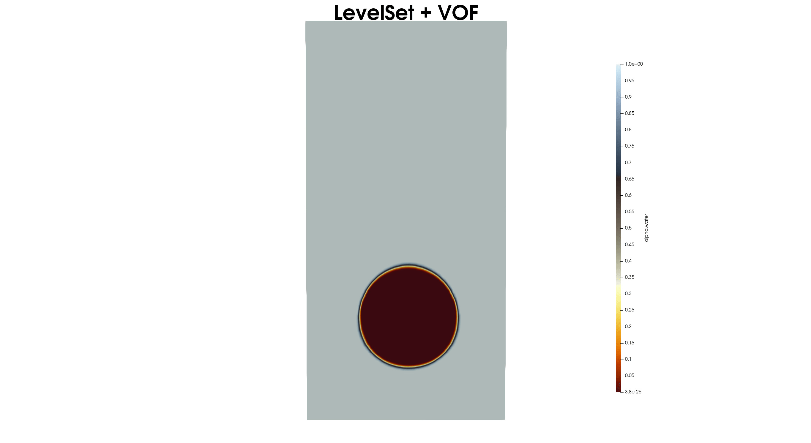

# Coupled Level-Set / VOF Solver for OpenFOAM


`interTrackFoam` simulates two incompressible, immiscible fluids. The volume
fraction is transported with VOF/MULES, which conserves mass. At every outer
corrector, a signed-distance level set is rebuilt from that volume fraction.
The level set then supplies the interface curvature and the smooth density
and viscosity that the momentum equation uses.



## How it works

All of the level-set work lives in one class, `levelSetCoupledMixture`
(`src/levelSetCoupledMixture`). It extends OpenFOAM's
`immiscibleIncompressibleTwoPhaseMixture`, so the rest of the solver
(MULES, turbulence, `fvOptions`, dynamic meshes) is unchanged. With `h` the
reference cell size, every rebuild does the following:

| Step | Operation |
|---|---|
| Seed | `d0 = (2 alpha1 - 1) * seedCoeff * h` |
| Redistance | `d <- d + dTau * sgn(d0) * (1 - \|grad d\|)`, `dTau = pseudoTimeCoeff * h`, `nRedistanceIter` times |
| Heaviside | `H = (1 + x + sin(pi x)/pi) / 2`, `x = clamp(d/eps, -1, 1)`, `eps = widthCoeff * h` |
| Curvature | `kappa = -div(n_f)`, `n_f = (grad d)_f / \|(grad d)_f\|` |
| Surface tension | `f_f = sigma * kappa_f * snGrad(H)` |
| Properties | `rho = H rho1 + (1-H) rho2`, `mu = H mu1 + (1-H) mu2` |

The density and the mass flux `rhoPhi` both come from `H`. The momentum
equation also removes the remaining mass imbalance,
`ddt(rho) + div(rhoPhi)`. Together, these keep `ddt(rho U)` and
`div(rhoPhi U)` consistent with each other. The coupling follows the
simple coupled level-set/VOF approach of Albadawi et al. (2013).

## Settings

Every entry is optional. They all go in a `levelSet` sub-dictionary of
`constant/transportProperties`. The surface tension coefficient is the usual
`sigma` entry.

```
levelSet
{
    cellSize         0.00625;   // h [m]; default: smallest cell spacing
    widthCoeff       1.5;       // interface half-width eps / h
    seedCoeff        0.75;      // |seed distance| / h
    pseudoTimeCoeff  0.1;       // redistance pseudo-time step / h
    nRedistanceIter  15;        // default: ceil(widthCoeff/pseudoTimeCoeff)
    curvatureFrom    levelSet;  // levelSet | volumeFraction
    propertiesFrom   levelSet;  // levelSet | volumeFraction
}
```

On graded meshes, set `cellSize` explicitly to the cell size near the
interface. The solver writes three extra fields: `levelSet` (signed distance),
`heaviside` and `levelSetCurvature`.

## Build

```bash
git clone https://github.com/cloner0110/LevelSet-VOF.git
cd LevelSet-VOF/src && wmake
```

Tested with OpenFOAM.com v2306, v2312 (CI), v2512 (CI) and v2606.

## Tutorial: 2-D rising bubble

`Tutorial/bubbleColumn` is test case 2 of Hysing et al. (2009):
ρ1/ρ2 = 1000, μ1/μ2 = 100, σ = 1.96, g = 0.98. The case writes the bubble's
centre of mass and its mean rise velocity at every time step, to
`postProcessing/bubble/0/volFieldValue.dat`.

```bash
cd Tutorial/bubbleColumn && ./Allrun
```

Benchmark results below are on a 1/h = 80 mesh (`(80 160 1)` cells,
`deltaT 7.8125e-4`, `cAlpha 1`), with OpenFOAM v2606. The reference is TP2D
from Hysing et al. (2009), Table XIII.

| Run | V<sub>max,1</sub> (t) | V<sub>max,2</sub> (t) | y<sub>c</sub>(t = 3) |
|---|---|---|---|
| TP2D, 1/h = 80 | 0.2638 (0.725) | 0.2597 (1.969) | 1.1370 |
| TP2D, 1/h = 640 | 0.2524 (0.733) | 0.2434 (2.071) | 1.1380 |
| this solver, level-set coupling (default) | 0.2450 (0.753) | 0.2274 (1.904) | 1.1085 |
| this solver, `curvatureFrom`/`propertiesFrom volumeFraction` | 0.2445 (0.750) | 0.2267 (1.910) | 1.1046 |

The level-set coupling also conserves the phase volume to all printed
digits.

## References

- Albadawi, A., Donoghue, D.B., Robinson, A.J., Murray, D.B., Delauré, Y.M.C.
  (2013). Influence of surface tension implementation in Volume of Fluid and
  coupled Volume of Fluid with Level Set methods for bubble growth and
  detachment. *Int. J. Multiphase Flow* 53:11–28.
- Hysing, S., Turek, S., Kuzmin, D., Parolini, N., Burman, E., Ganesan, S.,
  Tobiska, L. (2009). Quantitative benchmark computations of two-dimensional
  bubble dynamics. *Int. J. Numer. Meth. Fluids* 60:1259–1288.

## License

This solver is derived from OpenFOAM's `interFoam` and links against
OpenFOAM libraries. It is therefore distributed under the
[GNU General Public License v3](LICENSE), like OpenFOAM itself. Files that
derive from OpenFOAM keep the original OpenFOAM Foundation and OpenCFD
copyright lines.

OpenFOAM® is a registered trade mark of OpenCFD Ltd. This project is not
approved or endorsed by OpenCFD Ltd.

## Contact

- **Email**: [amirhossein.taran@ucdconnect.ie](mailto:amirhossein.taran@ucdconnect.ie)
- **Issues**: [GitHub Issues](https://github.com/cloner0110/LevelSet-VOF/issues)
